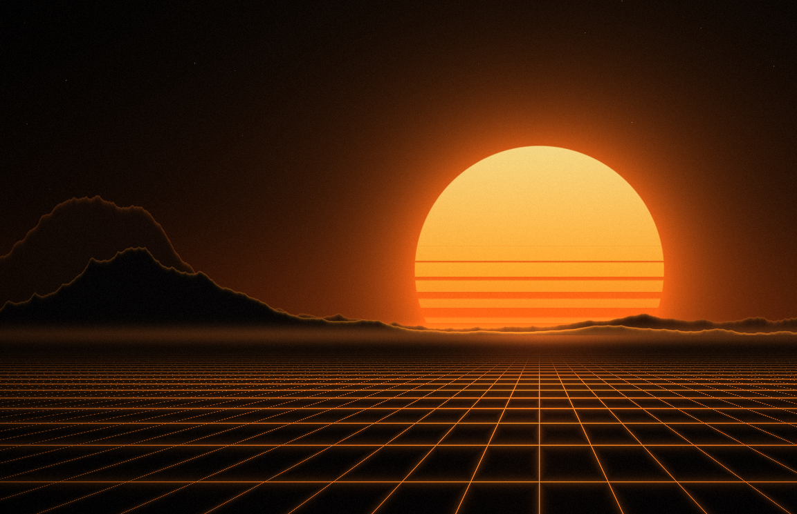

# emberwall

Random procedural wallpapers from the command line. Black and orange by default, any palette you like.



25 styles, from flat 2D patterns (topographic lines, dunes, flow fields, circuit boards, digital rain)
to raymarched 3D fractals (mandelbulb, Menger sponge, mandelbox). Every image is made from a seed,
so you can get one back exactly by passing the same style, seed and size.

Standard library Go only. No dependencies, no network.

## Install

```sh
go install github.com/dayvster/emberwall@latest
```

or clone and `go build`.

## Usage

```sh
emberwall                          # one random wallpaper at your screen size
emberwall -n 12                    # a dozen of them
emberwall -style topo,flow -n 6    # only these styles
emberwall -style topo -seed 42     # remake one you liked (style and seed are in the file name)
emberwall -palette ice             # another palette, or -palette random
emberwall -color '#3fa9f5'         # your own colour (1-3 hex colours)
emberwall -colors '#bd93f9,#ff79c6,#8be9fd,#50fa7b'   # several accents blended across the image
emberwall -set                     # also set the result as your wallpaper
emberwall -list                    # all styles and palettes
```

Images go to `~/Pictures/wallpapers/emberwall` unless you pass `-o`. `-size WIDTHxHEIGHT` overrides
the detected screen size, `-grain 0` turns off film grain and `-crt` adds an old curved-monitor look.

### Setting the wallpaper

`-set` works with:

- macOS (System Events)
- KDE Plasma (`plasma-apply-wallpaperimage`)
- swww
- hyprpaper

Screen size is detected with `hyprctl monitors` on Hyprland, then `xrandr`, and falls back to 3840x2160.

## Styles

topo, synthwave, dunes, eclipse, flow, ridges, halftone, embers, matrix, lava, circuit, truchet,
lowpoly, nebula, skyline, planet, wireframe, orbits, crt, digital, fractal, mandelbulb, bulbwide,
menger, mandelbox

## Palettes

ember, ice, rose, toxic, violet, blood, gold, teal, mono, sunset, aurora. Or any colours with
`-color` / `-colors`.

## License

MIT
